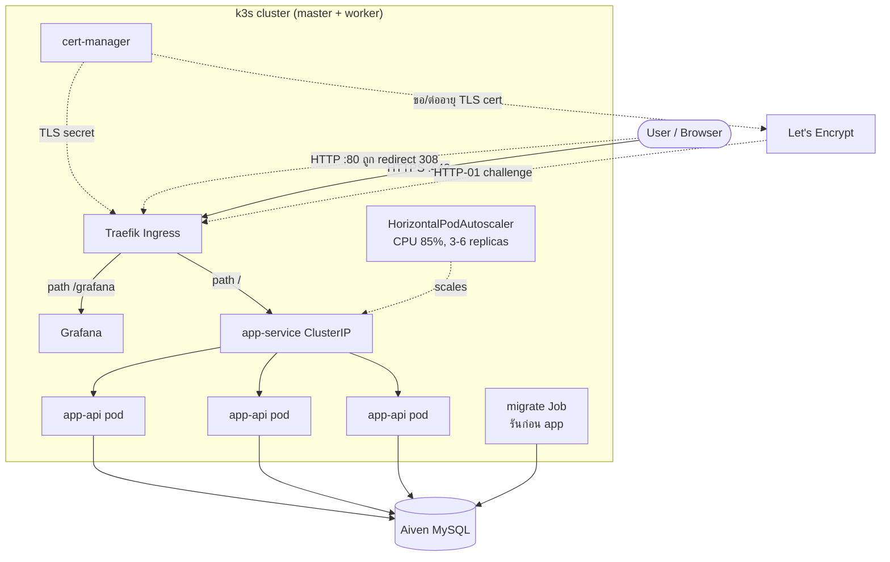
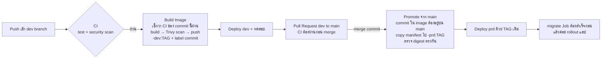

# DevOps Mini Project — Go API บน Kubernetes ที่ดูแลเอง

> โปรเจค DevOps แบบ end-to-end: นำ Go REST API มา containerize แล้ว deploy ขึ้น
> **k3s** Kubernetes cluster ที่ตั้งและดูแลเอง (provision ด้วย **Ansible**) รองรับหลาย environment พร้อม
> **CI/CD pipeline**, **security scanning**, **HTTPS อัตโนมัติ**, **monitoring**, **autoscaling**
> และ **image promotion** ที่ build ครั้งเดียวแล้วใช้ image ตัวเดิมจาก **dev → production**


🔗 **Live:** https://45.150.128.180.nip.io

> ใช้ Aiven MySQL free tier ซึ่งจะปิดตัวเองเมื่อไม่มีการใช้งาน หากเข้าไม่ได้แปลว่า
> database อยู่ในสถานะพัก

---

## ภาพรวม (Overview)

โปรเจคนี้สาธิต workflow การ deploy ที่ใกล้เคียงงานจริง สำหรับ web service ขนาดเล็ก —
ตั้งแต่ source code จนถึงแอปที่รันอยู่จริงผ่าน HTTPS มี monitoring และ auto-scale บน
infrastructure จริง (ไม่ใช่แค่ demo บนเครื่อง local)

Container image ตัวเดียวกันถูกใช้รัน 2 บทบาท โดยเลือกตอน runtime ผ่าน environment
variable:

- **`server`** — เปิดให้บริการ HTTP API
- **`migrator`** — รัน database migration ครั้งเดียวแล้วจบ (Kubernetes `Job`)

แยกออกเป็น 2 environment ที่อิสระจากกัน:

| Environment | Infrastructure | Database | เข้าถึง |
|---|---|---|---|
| **dev** | k3s บน VirtualBox VM 2 เครื่อง (master + worker) สร้างจาก playbook เดียวกับ prd | Aiven MySQL (database `*_dev`) | HTTP ผ่าน IP ของ VM |
| **prd** | k3s บน VPS 2 เครื่อง (control-plane 1 + worker 1) | Aiven MySQL (database production) | HTTPS ผ่าน `45.150.128.180.nip.io` |

> dev ไม่มี TLS เพราะอยู่ใน IP ภายใน Let's Encrypt ยิงเข้ามาตรวจ (HTTP-01) ไม่ถึง

---

## สถาปัตยกรรม (Architecture)

### Runtime architecture (production)



### CI/CD pipeline



---

## Tech Stack

| ส่วน | เครื่องมือ |
|---|---|
| **Language / Framework** | Go 1.26, Fiber v3, GORM |
| **Containerization** | Docker (multi-stage build บน alpine), GitHub Container Registry (GHCR) |
| **Orchestration** | Kubernetes (k3s), Traefik Ingress, Helm |
| **Infrastructure as Code** | Ansible (roles: common, k3s_server, k3s_agent, platform, github_runner), Ansible Vault |
| **TLS** | cert-manager, Let's Encrypt (HTTP-01) |
| **Security** | Trivy (scan repo + image ก่อน push), Kubernetes RBAC + Pod Security Admission, securityContext (non-root, read-only filesystem) |
| **CI/CD** | GitHub Actions, Docker Buildx (GHA layer cache), self-hosted runners, GitHub Environments |
| **Monitoring / Alerting** | Prometheus, Grafana, Alertmanager (kube-prometheus-stack), แจ้งเตือนผ่าน Discord |
| **Testing** | Go testing (table-driven, handler tests ด้วย fake repository, `-race`), k6 (load testing) |
| **Database** | MySQL (Aiven) |
| **Infrastructure** | VPS (production), VirtualBox (development) |

---

## ฟีเจอร์เด่น (Key Features)

- **Provision cluster ด้วย Ansible** — จาก Ubuntu เปล่าเป็น k3s cluster (master +
  worker) ในคำสั่งเดียว แบ่งเป็น 3 role: `common` (hostname, ปิด cloud-init network,
  ลบ search domain, firewall), `k3s_server` และ `k3s_agent` (worker ดึง token จาก
  master อัตโนมัติผ่าน `hostvars`) pin version ของ k3s ให้ตรงกับ prd, ซ่อน token
  ด้วย `no_log` และ **idempotent** (รันซ้ำได้ `changed=0`) ทดสอบบน VM โดยถอน k3s
  ออกแล้วสร้าง cluster ใหม่จาก playbook จากนั้นนำมาจัดการ **prd (VPS) จริง** โดยรัน
  `--check --diff` ก่อนเพื่อหา config drift แล้วค่อย apply ใช้ inventory แยกต่อ
  environment และเปิด/ปิด firewall ได้ด้วยตัวแปร (`manage_ufw`)
- **Platform เป็น code ทั้งหมด** — role `platform` ติดตั้ง helm (pin version),
  kube-prometheus-stack และ cert-manager ด้วย `kubernetes.core.helm` (pin chart version)
  และ apply ClusterIssuer + alert rules ด้วย `kubernetes.core.k8s` โดยอ่าน values และ
  manifest จาก `k8s/platform/` ใน repo โดยตรง (git เป็นแหล่งความจริงที่เดียว) Discord
  webhook เก็บใน **Ansible Vault** แล้วรวมเข้ากับ values **ในหน่วยความจำ** ไม่มีไฟล์ secret
  บนดิสก์ เปิด/ปิด cert-manager ต่อ environment ได้ และ pin collection ไว้ใน
  `requirements.yaml` นำมาครอบ prd ที่เคยติดตั้งด้วยมือได้ด้วย `--check --diff` ที่ผล
  เป็น `ok` ทั้งหมด (ของจริงตรงกับ repo ทุกอย่าง ไม่มี upgrade ซ้ำ)
- **ตรวจ drift ระดับ manifest ด้วย helm-diff** — Ansible เทียบ manifest ที่ render จริง
  กับ release ใน cluster แทนการเทียบแค่ values รันซ้ำได้ `changed=0` ทั้ง 2 environment
  (กำหนด Grafana admin password จาก Vault แทนการสุ่มของ chart ซึ่งทำให้ diff ทุกรอบ)
  และเมื่อ release เปลี่ยน จะ sync รหัสลงฐานข้อมูลของ Grafana ให้อัตโนมัติ
- **CI ได้สิทธิ์เท่าที่จำเป็น (least privilege)** — runner deploy ด้วย ServiceAccount
  `deployer` ที่มี Role เฉพาะใน namespace `devops-project` และเฉพาะ resource ที่ workflow
  ใช้จริง (Secret ของแอปจำกัดด้วย `resourceNames` จึงอ่าน TLS key ไม่ได้) ไม่มีสิทธิ์ระดับ
  cluster, แตะ namespace อื่นไม่ได้ และไม่มีสิทธิ์แก้ routing (Service/Ingress) เพราะ
  Traefik ใช้ร่วมกันทั้ง cluster — Trivy (KSV-0056) จับได้ว่าถ้า CI สร้าง Ingress ได้จะดัก
  path ของ namespace อื่นได้ จึงย้ายการ expose ไปให้ platform ดูแลแทนการ ignore
  namespace เปิด **Pod Security Admission `restricted`** ปฏิเสธ privileged pod แม้ผู้สั่ง
  จะเป็น admin ทดสอบสองทาง: deploy ผ่าน (สิทธิ์พอ) และคำสั่งนอกขอบเขตได้ `Forbidden`
  (สิทธิ์ไม่เกิน) — Role ถูกสร้างโดย Ansible ไม่ใช่ CI จึงแก้สิทธิ์ตัวเองไม่ได้
- **CI runner เป็น code และไม่ใช้ root** — role `github_runner` ติดตั้ง GitHub Actions
  self-hosted runner ให้รันด้วย user `gha-runner` (ไม่ใช่ root) ตรวจ tarball ด้วย sha256
  ขอ registration token ผ่าน GitHub API ด้วย fine-grained PAT ที่เก็บใน Vault และให้
  kubeconfig ของตัวเองผ่าน `.env` ของ runner — ย้าย runner บน prd ที่เคยรันเป็น root
  มาใช้ role นี้ และย้าย dev มารันบน cluster ที่สร้างจาก playbook เดียวกับ prd
- **Supply chain ของสคริปต์ติดตั้ง** — สคริปต์ติดตั้ง k3s ถูกตรวจด้วย sha256 ที่ pin
  ไว้คู่กับ `k3s_version` ถ้าสคริปต์ถูกแก้จะไม่ถูกรันด้วย root
- **SSH keys เป็น code** — public key ของทุกเครื่องที่เข้าได้อยู่ใน repo และถูกใส่ด้วย
  `authorized_key` (comment ตามชื่อไฟล์) เพิ่ม/ถอนสิทธิ์ผ่าน PR
- **Server hardening** — firewall (ufw) แบบ deny เป็นค่าเริ่มต้น เปิดสาธารณะแค่
  22/80/443 และ SSH รับเฉพาะ key (ปิด password และ keyboard-interactive, root เข้าได้
  ด้วย key เท่านั้น) ตรวจ syntax ด้วย `sshd -t` ก่อนวางไฟล์ และยืนยันค่าที่ใช้จริงด้วย
  `sshd -T`
- **Build pipeline ที่สแกนของชิ้นเดียวกับที่ส่งออก** — Build Image จะ build ได้ก็ต่อเมื่อ
  CI (`test` + `security`) ของ commit นั้นผ่านแล้ว (ตรวจผ่าน GitHub API) จากนั้น build
  ครั้งเดียวด้วย Buildx (`load: true`) → Trivy สแกน image (เจอ CRITICAL ที่มีแพตช์ → หยุด)
  → push **image ตัวที่สแกน** ไม่ build ใหม่ ติด label มาตรฐาน OCI
  (`org.opencontainers.image.revision` = commit, `.source` = repo) และใช้ layer cache
  ข้ามรอบ (`type=gha`) tag ห้ามซ้ำ (immutable) จึงใช้ `imagePullPolicy: IfNotPresent` ได้ปลอดภัย
- **Image promotion (build once, deploy many)** — promote image ตัวเดิมจาก `-dev` ไป `-prd`
  ด้วย `docker buildx imagetools create --prefer-index=false` (copy manifest ภายใน registry
  ไม่ build ใหม่ ไม่ดาวน์โหลด layer) แล้วตรวจว่า **digest ของ dev และ prd ตรงกัน**
  ก่อน promote ตรวจว่า **commit ที่อยู่ใน image (อ่านจาก label) อยู่บน `main` แล้ว**
  (`git merge-base --is-ancestor`) จึงมั่นใจว่าโค้ดผ่าน PR + CI จริง ไม่ใช่แค่กด workflow จาก
  main และห้ามเขียนทับ tag ที่มีอยู่แล้วบน prd
- **Security scanning (Trivy)** — CI สแกน repository (ช่องโหว่ของ dependency รวมตัวทางอ้อม,
  secret ที่หลุดในโค้ด, misconfiguration ของ Dockerfile/Kubernetes manifest) เจอ HIGH/CRITICAL
  ที่มีแพตช์แล้วจะ fail และเป็น required check ก่อน merge เข้า `main` ส่วน image (รวมแพ็กเกจ
  ของ base image ที่สแกน repo มองไม่เห็น) ถูกสแกนก่อน push ใน Build Image
- **Container hardening** — รันเป็น non-root user (UID 10001), root filesystem แบบ
  read-only, ตัด Linux capabilities ทั้งหมด, ปิด privilege escalation และใช้
  seccomp profile `RuntimeDefault`
- **Multi-stage Docker build** — แยก stage build ออกจาก runtime ทำให้ image เล็กลงมาก
  และฝัง build metadata (version, build time, commit SHA) ลงใน binary ผ่าน `-ldflags`
  แสดงผลที่ endpoint `/about`
- **Database migration เป็น Kubernetes Job** ที่ต้องสำเร็จก่อนจะ rollout แอป โดยใช้
  image ตัวเดียวกันในโหมด `migrator` workflow รอทั้งกรณีสำเร็จและล้ม ถ้าล้มจะพิมพ์ log
  ของ Job ลงใน workflow แล้วหยุด แอปเวอร์ชันเดิมยังรันต่อ
- **แยก health probes ชัดเจน**:
  - `/livez` (liveness) — เช็คแค่ว่า process ยังทำงาน **ไม่แตะ DB** DB ล่มระหว่างรันจึง
    ไม่ทำให้ pod ถูก restart วนซ้ำ (restart ไม่ได้แก้ปัญหาที่ DB)
  - `/readyz` (readiness) — ping database ภายใน **800ms** (สั้นกว่า timeout 1 วินาทีของ
    probe) ไม่ผ่านตอบ 503 → pod หยุดรับ traffic แต่ไม่ถูก restart และกลับมาเองเมื่อ DB ฟื้น
    timeout ทำให้ไม่มี request ค้างจอง connection ไว้เมื่อ DB ค้าง
  - หมายเหตุ: ครอบคลุมกรณี DB ล่ม**ระหว่างรัน** ถ้า DB ล่มตอน pod เริ่ม แอปจะต่อ DB ไม่ได้
    แล้วจบ (CrashLoopBackOff) จนกว่า DB จะกลับมา
- **HTTP status ตามความหมาย** — input ผิด 400, username ซ้ำ 409 (unique index +
  `TranslateError`), ไม่พบ user 404, สร้างสำเร็จ 201 ส่วน 500 บันทึกสาเหตุจริงใน log
  แต่ตอบผู้ใช้แค่ `internal error`
- **HTTPS อัตโนมัติ** — cert-manager ขอและต่ออายุ certificate จาก Let's Encrypt
  ทดสอบกับ staging issuer ก่อนเปลี่ยนเป็น production เพื่อเลี่ยง rate limit
  และ redirect HTTP → HTTPS ทุก request ด้วย Traefik Middleware
- **Horizontal Pod Autoscaler** — scale `app-api` จาก 3 ถึง 6 replicas ที่ CPU
  85% (ทดสอบด้วย k6)
- **Handler tests โดยไม่ต้องมี database** — service รับ `UserRepository` (interface) ผ่าน
  dependency injection test จึงส่ง fake repository ที่กำหนดได้ว่าจะคืนอะไร แล้วยิง HTTP
  เข้า handler จริง ครอบ 201/400/404/409/500, `/livez` ยังตอบ 200 แม้ DB พัง และ `/readyz`
  ต้องตอบ 503 ภายใน 950ms เมื่อ DB ค้าง รันใน CI ด้วย `-race -cover` ก่อน merge ทุกครั้ง
- **การแยก config ตาม environment** — secret แยกผ่าน GitHub Environments,
  ConfigMap และ Ingress แยกไฟล์ต่อ environment
- **แยก platform กับ application** — Ansible ดูแลของที่ตั้งครั้งเดียวต่อ cluster
  (`k8s/platform/`: namespace + Pod Security, RBAC ของ CI, Service/Ingress ของแอป,
  monitoring, cert-manager) ส่วน CI deploy เฉพาะ workload ที่เปลี่ยนทุก release
  (Secret, ConfigMap, migration Job, Deployment, HPA)
- **Monitoring stack** — Prometheus + Grafana ติดตั้งผ่าน Helm เปิดที่ `/grafana`
- **Alert เมื่อ certificate ใกล้หมดอายุ** — ให้ Prometheus เก็บ metrics ของ cert-manager
  ผ่าน ServiceMonitor แล้วเขียน `PrometheusRule` 2 ตัว: เตือนเมื่อ cert เหลือน้อยกว่า
  14 วัน (cert-manager ต่ออายุตอนเหลือ 30 วัน alert จึงดังเฉพาะเมื่อการต่ออายุล้มเหลว
  ต่อเนื่อง) และเมื่อ cert ไม่ Ready นาน 15 นาที Alertmanager ส่งเข้า Discord เฉพาะ
  alert เรื่อง cert (กัน alert ของ component ที่ k3s ไม่ได้แยก process ออกมา) และแจ้ง
  ตอนปัญหาหายด้วย ทดสอบทั้งเส้นโดยลดเงื่อนไขชั่วคราวให้ alert ดังจริง webhook URL
  เก็บใน Ansible Vault

---

## CI/CD และ Branching Strategy

โปรเจคใช้ flow **dev → main** พร้อม branch protection:

1. งานทั้งหมดทำบน branch **`dev`**
2. ทุกครั้งที่ push/PR **CI workflow** จะรันอัตโนมัติ 2 job:
   - `test` — ตรวจ `go mod tidy` → `go vet` → `go build` → `go test`
   - `security` — Trivy สแกน repository และ container image
3. **Build image ครั้งเดียว** เป็น `devopsminiproject-dev:<tag>` (ต้องผ่าน CI ของ commit นั้น
   ก่อน และ image ต้องผ่าน Trivy ก่อน push) แล้ว deploy ขึ้น **dev** เพื่อทดสอบบน cluster จริง
4. **Pull Request** จาก `dev` เข้า `main` ต้องให้ `test` และ `security` ผ่านก่อน
   ถึง merge ได้ (บังคับด้วย branch ruleset บน `main`) และ merge แบบ **merge commit**
   เพื่อให้ commit ที่ build ไว้อยู่ในประวัติของ `main`
5. **Promote** image tag เดิมจาก `-dev` ไป `-prd` (รันจาก `main` เท่านั้น) โดยไม่
   build ใหม่ ตรวจว่า commit ใน image อยู่บน `main` และ digest ตรงกัน
6. **Deploy ขึ้น production แบบ manual** ด้วย tag เดิม (คุมจังหวะการ release เอง)

| Workflow | Trigger | หน้าที่ |
|---|---|---|
| `ci.yaml` | push / PR | test (tidy, vet, build, test `-race -cover`) และ security (Trivy scan) ยกเลิกรอบเก่าเมื่อ push ซ้ำ |
| `workflow.yaml` | manual | เช็ก CI → build (Buildx + cache) → Trivy scan → push image **dev** เข้า GHCR ใช้ tag แบบ calendar versioning ห้ามซ้ำ |
| `promote.yaml` | manual | promote image จาก dev ไป prd โดยไม่ build ใหม่ ตรวจ commit อยู่บน main และ digest ตรงกัน |
| `workflow-deploy.yaml` | manual | deploy ขึ้น dev หรือ prd (self-hosted runner แยก label ต่อ environment, ใช้สิทธิ์ของ SA `deployer`) |

> `GITHUB_TOKEN` ของแต่ละ workflow ได้สิทธิ์เท่าที่ใช้ (`permissions:`) และค่าที่ผู้ใช้พิมพ์เข้ามา
> (เช่น tag) ถูกส่งผ่าน `env:` แทนการแทรก `${{ }}` ลงในสคริปต์ตรง ๆ เพื่อกัน script injection

> ใช้ 2 package ใน GHCR (`devopsminiproject-dev` และ `devopsminiproject-prd`) แทน
> registry แยกต่อ environment ใน `-prd` จึงมีเฉพาะ image ที่ผ่านการทดสอบบน dev และ
> ผ่าน PR มาแล้วเท่านั้น

> ตอนนี้เป็น **Continuous Delivery** — pipeline พร้อม deploy ตลอด แต่ขั้นขึ้น
> production ตั้งใจให้เป็น manual เพื่อคุมจังหวะการ release ส่วน CI gate
> ทำหน้าที่ปกป้อง branch `main`

---

## โครงสร้างโปรเจค (Repository Structure)

```
.
├── cmd/                      # Entrypoint ของแอป (โหมด server / migrator)
├── di/                       # setup: config (อ่าน env ครั้งเดียว), database, server
├── service/
│   ├── router/               # ผูก URL → handler และประกอบ dependency (repository → services)
│   ├── user/                 # POST/GET/DELETE /user + handler tests (fake repository)
│   ├── healthz/              # /livez, /readyz (timeout 800ms) + tests
│   ├── statushome/           # หน้า /
│   └── statusabout/          # หน้า /about
├── repository/               # Data access layer (GORM) + interface UserRepository
├── entity/                   # Domain models
├── util/                     # Build info, request validation + unit tests
├── k8s/                      # ===== CI deploy (ของแอป ทุก release) =====
│   ├── configmap-dev.yaml / configmap-prd.yaml
│   ├── app.yaml              # Deployment
│   ├── job.yaml              # DB migration Job
│   ├── hpa.yaml              # HorizontalPodAutoscaler
│   └── platform/             # ===== Ansible apply (ตั้งครั้งเดียวต่อ cluster) =====
│       ├── app-namespace.yaml        # namespace + Pod Security restricted
│       ├── deployer-rbac.yaml        # ServiceAccount + Role ของ CI
│       ├── app-network-vm.yaml / app-network-prd.yaml       # Service + Ingress ของแอป
│       ├── grafana-ingress-vm.yaml / grafana-ingress-prd.yaml
│       ├── cluster-issuer.yaml       # Let's Encrypt staging + production
│       ├── cert-manager-values.yaml  # ค่าของ cert-manager (เปิด ServiceMonitor)
│       ├── cert-alerts.yaml          # PrometheusRule: cert ใกล้หมดอายุ / ไม่ Ready
│       └── monitoring-values.yaml    # ค่าของ kube-prometheus-stack + Alertmanager route
├── ansible/                  # Provision k3s cluster (IaC)
│   ├── inventory.ini         # dev (VM master / worker)
│   ├── inventory-prd.ini     # VPS production
│   ├── site.yaml             # common → k3s_server → k3s_agent → platform → github_runner
│   ├── requirements.yaml     # pin Ansible collections
│   ├── secrets/              # vm.yaml / prd.yaml เข้ารหัสด้วย Ansible Vault
│   └── roles/
│       ├── common/           # SSH keys, SSH hardening, hostname, cloud-init, netplan, ufw
│       ├── k3s_server/       # ติดตั้ง server, อ่าน token, ตั้ง kubeconfig
│       ├── k3s_agent/        # ติดตั้ง agent แล้ว join master
│       ├── platform/         # helm, monitoring, cert-manager, apply k8s/platform/*
│       └── github_runner/    # self-hosted runner (user gha-runner, kubeconfig ของ deployer)
├── .github/workflows/        # CI + security scan, build, promote, deploy pipelines
└── Dockerfile                # Multi-stage build
```

---

## API Endpoints

| Method | Path | คำอธิบาย | Status |
|---|---|---|---|
| `GET` | `/` | ภาพรวมสถานะ runtime | 200 |
| `GET` | `/about` | ข้อมูล service (version, build time, commit) | 200 |
| `GET` | `/livez` | Liveness probe (เช็คแค่ process) | 200 |
| `GET` | `/readyz` | Readiness probe (ping DB ภายใน 800ms) | 200 / 503 |
| `GET` | `/user` | ดูรายชื่อ user ทั้งหมด | 200 / 500 |
| `POST` | `/user` | สร้าง user (`username` ≥ 3 ตัวอักษร, `name` บังคับ) | 201 / 400 / 409 / 500 |
| `DELETE` | `/user` | ลบ user ตาม `username` | 200 / 400 / 404 / 500 |

---

## Testing

```bash
go test ./... -race -cover
```
- **handler tests** (`service/user`, `service/healthz`) ใช้ fake repository แทน database
  จึงรันได้ทุกที่ รวมถึงใน CI โดยไม่ต้องมี MySQL
- **unit tests** ของ build info (`util`) เช่น แปลงเวลา RFC3339 เป็นเวลาไทยและรับมือค่าผิดรูปแบบ
- ส่วนที่ fake repository ครอบไม่ถึง (คำสั่ง SQL จริง, unique index) ทดสอบบน dev cluster

---

## Monitoring และ Autoscaling

- **Grafana dashboards** (จาก kube-prometheus-stack) ติดตาม CPU/memory ราย pod,
  ราย namespace และราย node
- **Alerting** — แจ้งเตือนเข้า Discord เมื่อ TLS certificate ใกล้หมดอายุหรือไม่ Ready
- **Load testing ด้วย k6** ยิง traffic เข้า API เพื่อยืนยันว่า HPA scale replicas
  ขึ้นเมื่อ CPU สูงต่อเนื่อง และ scale ลงหลังพ้น stabilization window

<!-- ย้ายไฟล์ image.png เดิมมาไว้ที่ docs/ แล้วตั้งชื่อให้ตรงกับด้านล่าง -->


---

## การตั้ง cluster ใหม่ (Platform Setup)

ขั้นตอนที่ทำครั้งเดียวต่อ cluster ก่อน deploy แอปผ่าน workflow ครั้งแรก:

1. เตรียมเครื่อง Ubuntu 24.04 ที่มี **IP คงที่** และ SSH ด้วย key ได้ แล้วใส่ใน
   `ansible/inventory.ini`
2. สร้างไฟล์ secret ด้วย Ansible Vault (ใส่ `discord_webhook_url`, `grafana_admin_password`
   และ `github_runner_pat` — fine-grained PAT เฉพาะ repo นี้ สิทธิ์ Administration: Read and write)
   และติดตั้ง collection:
   ```bash
   cd ansible
   ansible-galaxy collection install -r requirements.yaml
   ansible-vault create secrets/vm.yaml
   ```
3. สร้าง cluster, platform และ CI runner ทั้งหมดในคำสั่งเดียว (OS, firewall, k3s server
   + agent, helm, kube-prometheus-stack, cert-manager, ClusterIssuer, alert rules,
   GitHub Actions runner ที่มี label ตาม `github_runner_name` ใน inventory):
   ```bash
   ansible-playbook site.yaml -K --ask-vault-pass
   # prd: ansible-playbook -i inventory-prd.ini site.yaml --ask-vault-pass --check --diff
   ```
4. ถ้าผู้ให้บริการมี firewall ภายนอก ให้เปิด port 22, 80 และ 443 (firewall ของ OS
   จัดการโดย Ansible แล้ว — เปิดสาธารณะแค่ 3 port นี้ และให้ node คุยกันได้ทุก port)

> cluster prd ถูกตั้งด้วยมือก่อนมี playbook ขั้นตอนที่ทำมือและปัญหาที่เจอ
> (hostname ซ้ำ, search domain, kubeconfig) ถูกนำมาเขียนเป็น playbook ทดสอบบน VM
> แล้วนำมาใช้กับ prd ด้วย `ansible-playbook -i inventory-prd.ini site.yaml --check --diff`
> ก่อน apply จริง ส่วน Helm charts ที่เคยติดตั้งด้วยมือถูกเก็บ values ไว้ใน git ตั้งแต่แรก
> playbook จึงรับมาดูแลต่อได้โดยไม่มีการเปลี่ยนแปลง ปัจจุบัน prd ถูกจัดการด้วย playbook
> ชุดเดียวกันทั้งหมด (รันซ้ำได้ `changed=0`)

---

## ผู้จัดทำ (Author)

- **Name:** Thanut Sukprasertsom
- **Email:** thanutsukprasertsomm@hotmail.com
- **GitHub:** https://github.com/thanutgit
- **LinkedIn:** https://www.linkedin.com/in/thanut-sukprasertsom-b77048386/